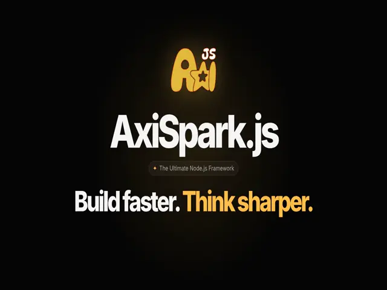

<p align="center" style="font-size: 40px; margin-bottom: 0; font-weight: bold;">
  AxiSpark.js
</p>

<p align="center" style="font-size: 22px; margin-bottom: 40px; font-weight: 600;">
  The Ultimate <a href="https://nodejs.org" target="_blank">Node.js</a> Framework
</p>
<div align="center">

[](https://github.com/axisparkjs/axispark/blob/main/LICENSE)
[](https://www.npmjs.com/org/axisparkjs)
[](https://axisparkjs.com/)

</div>

## Description

AxiSpark.js is a powerful and flexible Node.js framework designed to simplify the development of web applications. It uses modern TypeScript features and provides a robust set of tools and libraries to help developers build scalable and maintainable applications.

## Philosophy

JavaScript and Node.js make it easy to build powerful applications, but as projects grow, keeping them simple, organized, and maintainable becomes a challenge. AxiSpark.js was created to provide a simple and flexible architecture for building modern applications without unnecessary complexity.

AxiSpark.js focuses on simplicity, clarity, and scalability, giving developers the freedom to start small and grow naturally as their applications evolve.

## Getting Started

Create a new project with the AxiSpark CLI:

```bash
npm install -g @axisparkjs/cli
axispark create my-app
```

Then follow the [official documentation](https://axisparkjs.com/docs/intro).

## Packages

Everything is a plugin: install only what your application needs. All packages live in the [axispark](https://github.com/axisparkjs/axispark) monorepo.

| Area | Packages |
| --- | --- |
| Core | `@axisparkjs/core`, `@axisparkjs/common`, `@axisparkjs/di`, `@axisparkjs/engine`, `@axisparkjs/logger` |
| HTTP | `@axisparkjs/http`, `@axisparkjs/http-express`, `@axisparkjs/http-fastify`, `@axisparkjs/openapi` |
| Security | `@axisparkjs/security` |
| WebSocket | `@axisparkjs/websocket`, `@axisparkjs/websocket-socketio` |
| Data & messaging | `@axisparkjs/data`, `@axisparkjs/kafka`, `@axisparkjs/rabbitmq` |
| Scheduling | `@axisparkjs/schedule` |
| Architecture | `@axisparkjs/ddd` |
| Tooling | `@axisparkjs/cli`, `@axisparkjs/test` |

## Repositories

| Repository | Description |
| --- | --- |
| [axispark](https://github.com/axisparkjs/axispark) | Framework packages, CLI templates and samples. |
| [website](https://github.com/axisparkjs/website) | Documentation website. |
| [.github](https://github.com/axisparkjs/.github) | Organization profile, community health files and issue templates. |

## Contributing

Contributors are welcome! Read the [contributing guidelines](https://github.com/axisparkjs/.github/blob/main/CONTRIBUTING.md) and our [Code of Conduct](https://github.com/axisparkjs/.github/blob/main/CODE_OF_CONDUCT.md) before getting started.

- 🐛 Found a bug or missing a feature? [Open an issue](https://github.com/axisparkjs/axispark/issues/new/choose).
- 🔒 Found a security vulnerability? Follow the [Security Policy](https://github.com/axisparkjs/.github/blob/main/SECURITY.md).
- 💬 Need help? See [Support](https://github.com/axisparkjs/.github/blob/main/SUPPORT.md).

## License

AxiSpark.js is [Apache 2.0 licensed](https://github.com/axisparkjs/axispark/blob/main/LICENSE).
